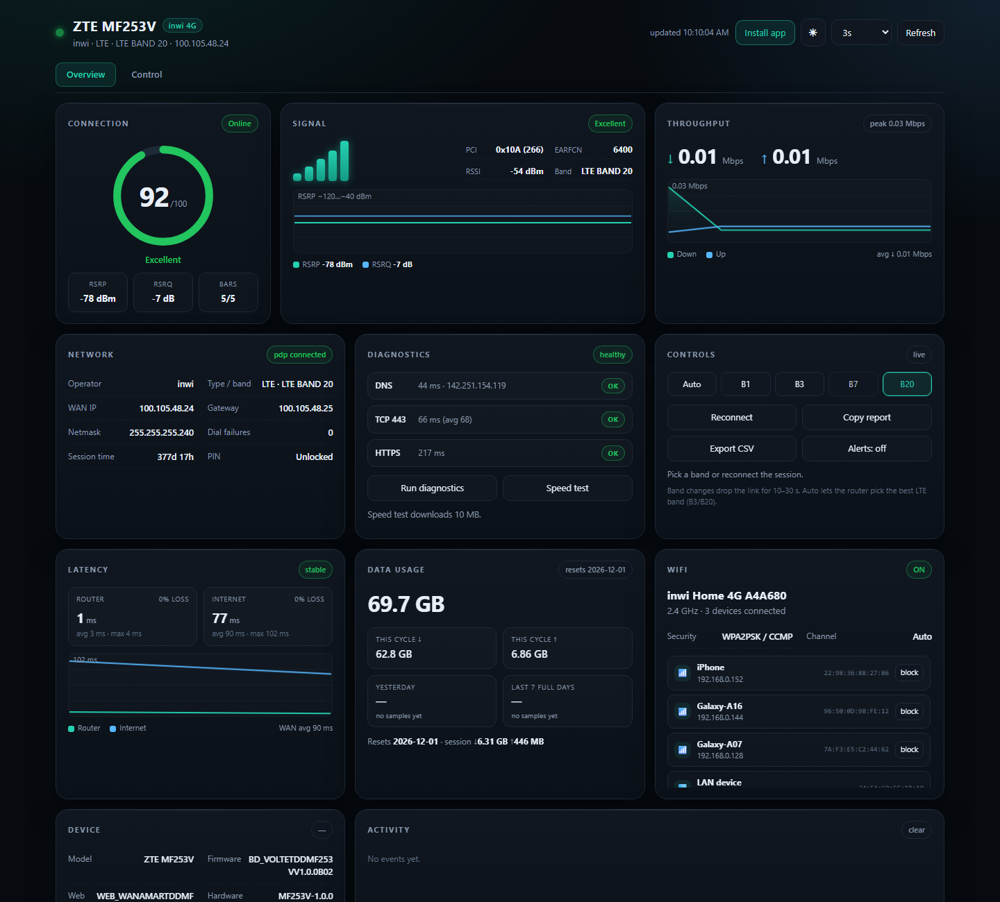

# ZTE 4G dashboard

A local, self-hosted web dashboard for the **ZTE MF253V** 4G/LTE router
(inwi firmware). It shows live signal, throughput, latency and data usage, and
lets you control the connection, bands, WiFi, APN/DNS, client blocking and the
router itself — all from one page.

The router's web server sends no CORS headers and its login session expires
after roughly one request. `server.js` is therefore a small Node proxy: it logs
into the router, fetches the values, and serves them to the page from the same
origin. No dependencies, no build step, no cloud.



## Features

**Monitoring**

- Signal — RSRP, RSRQ, RSSI, bars, PCI, EARFCN, quality label
- Connection score — 0–100 ring from signal and link state
- Throughput — live ↓/↑ Mbps, peak/avg, 90-sample area chart
- Signal history — RSRP + RSRQ chart
- Network — operator, type/band, WAN IP, gateway, netmask, dial failures,
  session time
- Diagnostics — DoH DNS, TCP 443 and HTTPS checks with pass/fail pills
- Latency monitor — 10 s TCP probes to the router and the internet, with
  min/avg/max, packet loss and a dual-line chart
- Speed test — server-side 10 MB download, Mbps and MB/s, local history
- Data usage — live cycle total, yesterday (00:00–24:00), last 7 full days,
  session totals, optional plan-limit bar
- Past cycles — click **History** in the top bar to see the current and all
  saved cycles; previous months stay after the router resets its counters
- Daily availability report — uptime, WAN latency and loss per day, CSV export
- Connected clients — WiFi and LAN devices with name, IP and MAC
- Activity log — link, DNS, signal, band, reconnect and speed-test events
- Live tab — the title shows current download speed, the favicon turns
  green / amber / red with the link state
- Dark / light theme and a responsive phone layout

**Controls**

- Connect / disconnect the mobile session
- Reconnect (disconnect + reconnect the PDP session)
- Band lock — Auto / B1 / B3 / B7 / B20
- Network scan and manual operator selection
- WiFi on/off, SSID, password, hidden SSID, channel
- APN editor — profile name, APN, auth, username, password, PDP type and
  manual DNS
- Data limit — size, unit, alert percent, reset day, auto-clear
- Client blocking by MAC
- Router reboot (with confirmation)
- PWA install on localhost or HTTPS
- Browser alerts on link drop/recovery, DNS failure and weak signal

## Requirements

- Node.js 18 or newer (no npm packages needed)
- A computer on the same LAN as the router
- ZTE MF253V reachable at `http://192.168.0.1` with admin access

The dashboard was written against firmware
`BD_VOLTETDDMF253VV1.0.0B02`. Other ZTE firmware may use different command
names; the proxy is easy to adjust in `server.js`.

## Quick start

```bash
git clone https://github.com/mraiess/zte-4g-dashboard.git
cd zte-4g-dashboard
node server.js
```

Then open <http://127.0.0.1:8787>.

On Windows you can also double-click **`start.cmd`**, which starts the server
and opens the browser.

| Command | What it does |
|---|---|
| `start.cmd` | Start on `127.0.0.1:8787` (this PC only) |
| `start.cmd lan` | Bind to the LAN too; the console prints the phone URL |
| `stop.cmd` | Stop whatever is listening on port 8787 |
| `node server.js` | Manual start, then open <http://127.0.0.1:8787> |

## Configuration

All settings are optional environment variables:

| Variable | Default | Meaning |
|---|---|---|
| `ROUTER` | `http://192.168.0.1` | Router base URL |
| `ROUTER_PASS` | `admin` | Router admin password |
| `PORT` | `8787` | Local HTTP port |
| `HOST` | `127.0.0.1` | Bind address (`0.0.0.0` for LAN) |

PowerShell example:

```powershell
$env:ROUTER_PASS = "your-password"
$env:HOST = "0.0.0.0"
node server.js
```

## API

| Method | Path | Purpose |
|---|---|---|
| `GET` | `/api/status` | Live router stats (cached 1.2 s) |
| `GET` | `/api/clients` | Connected WiFi + LAN devices |
| `GET` | `/api/diag` | DNS + TCP + HTTPS health check |
| `GET` | `/api/latency` | LAN/WAN latency samples, min/avg/max and loss |
| `GET` | `/api/settings` | Current WiFi, APN, limit and block settings |
| `GET` | `/api/report?days=7` | Daily availability report |
| `GET` | `/api/usage` | Cycle total + yesterday + last 7 full days |
| `GET` | `/api/history` | Saved totals for past cycles |
| `GET` | `/api/speedtest?bytes=10000000` | Server-side download test |
| `GET` | `/api/health` | Liveness and version |
| `POST` | `/api/band` | `{ "band": "auto"\|"b1"\|"b3"\|"b7"\|"b20" }` |
| `POST` | `/api/reconnect` | Disconnect + reconnect the PDP session |
| `POST` | `/api/connection` | `{ "action": "connect"\|"disconnect" }` |
| `POST` | `/api/wifi` | `{ enabled?, ssid?, password?, hidden?, channel? }` |
| `POST` | `/api/apn` | `{ profileName, wanApn, authMode, username, password, dnsMode, dns1, dns2 }` |
| `POST` | `/api/limit` | `{ enabled, size, unit, alertPercent, clearDate, autoClear }` |
| `POST` | `/api/mac` | `{ action: "block"\|"unblock"\|"clear", mac, host, ip }` |
| `POST` | `/api/scan` | Scan for available networks |
| `POST` | `/api/operator` | `{ auto: true }` or `{ numeric, rat }` |
| `POST` | `/api/reboot` | `{ confirm: "REBOOT" }` |

## How data usage is measured

The router only exposes **cumulative cycle counters** (`monthly_rx_bytes`,
`monthly_tx_bytes`) — there are no daily counters and no traffic history.

`server.js` appends one sample every 60 seconds to `report.jsonl`:

```json
{"ts":1794781785622,"linked":true,"rsrp":-76,"rsrq":-8,"band":"LTE BAND 20","lan":1,"wan":59,"rx":48412381512,"tx":5816197281}
```

`rx` / `tx` are the router's running counters, not per-minute usage. Window
totals are computed on request by summing the differences between consecutive
samples inside local-midnight boundaries:

- **Yesterday** — local 00:00 → 24:00
- **Last 7 full days** — the seven complete days ending yesterday
- **This cycle** — read live from the router

Because there is no historical data to backfill, the calendar windows show
`partial` until the dashboard has sampled across a full window, and `no samples
yet` before that. The same file powers the availability report. Samples are
kept for 30 days, and the file stores only aggregate byte counts, link state,
signal and latency — no browsing history, domains or per-device traffic.

### Past cycles

`report.jsonl` is pruned after 30 days, so monthly totals are written to a
separate small file, `usage-history.json` (also git-ignored). On every status
read the server saves a snapshot for the router's current `date_month`, keeping
the highest value seen. When `date_month` changes, the old entry is left as the
final total for that cycle and the **Past cycles** card lists it as
`Cycle YYYY-MM-DD` with its ↓/↑ and combined total. Up to 24 cycles are kept.

A snapshot is written at most once per minute. If the server is stopped when
the month rolls over, the saved total is the last value seen before it stopped;
a cycle that ended entirely while the server was off cannot be recovered from
the router.

## Firmware notes

- **Band changes drop the link for 10–30 s.** `Auto` is the router's all-LTE
  preset (`0x2000080044`, B3/B7/B20/B38). B20 can report
  `LIMITED_SERVICE_LTE` while B3 still carries data. If the link falls back to
  slow WCDMA/3G, choose **Auto** and reconnect to recover LTE. B7 had no
  service in testing.
- `RadioOff=1` means WiFi **ON** in this firmware, and `broadcastSsidEnabled=0`
  means the SSID is **visible**.
- `SCAN_NETWORK` is unsupported by this firmware, so the network scan list
  stays empty; manual operator selection works but drops the PDP session.
- USSD and SMS are broken on this firmware.
- Keep **DNS mode: Auto**. On this connection the router cannot reach
  `1.1.1.1` / `8.8.8.8` as manual upstream servers, so manual DNS makes all
  lookups time out. The carrier relay is the only working upstream.
- The router DNS relay stalls intermittently for minutes. The dashboard uses
  DNS-over-HTTPS (`dns.google`, fallback `cloudflare-dns.com`) for its DNS,
  HTTPS and speed-test checks, with a 60 s cache that is primed at startup,
  after each reconnect and every 5 minutes.
- WiFi passwords are read and written base64-encoded (`WPAPSK1_encode`).

## Security

- Binds to `127.0.0.1` by default, so only this machine can reach it.
- `start.cmd lan` / `HOST=0.0.0.0` exposes it to the LAN with **no
  authentication**. Use it only on a network you trust.
- The router password is read from `ROUTER_PASS` or the default in
  `server.js`. Set `ROUTER_PASS` in your environment rather than editing the
  file if the repository is public.
- The PWA service worker only installs on `localhost` or HTTPS; plain HTTP over
  the LAN cannot install it.
- `report.jsonl` is runtime data and is git-ignored.

## Project structure

```
server.js               Node proxy + all API endpoints
index.html              dashboard UI (single file, no build step)
manifest.webmanifest    PWA manifest
service-worker.js       network-first shell cache
icon-192.png            app icons
icon-512.png
icon.svg
start.cmd               Windows launcher (local / LAN mode)
stop.cmd                stop the server on port 8787
report.jsonl            runtime samples (created on first run, git-ignored)
usage-history.json      saved monthly totals (created on first run, git-ignored)
```

## Troubleshooting

| Symptom | Fix |
|---|---|
| `Router did not return live data` | Check the router IP and `ROUTER_PASS`; open `http://192.168.0.1` in a browser |
| Login works in the browser but not here | The session expired; the proxy logs in before every call — check the password |
| 3G instead of LTE | Click **Auto**, then **Reconnect** |
| DNS/HTTPS show `FAIL` or pages hang | Lock **B3** (band test: 2.1 Mbps vs 0.5 Mbps on B20), keep DNS mode **Auto**, then reconnect |
| Browser pages still stall while diagnostics pass | Enable Secure DNS / DoH in the browser with `https://cloudflare-dns.com/dns-query`; plain UDP DNS to public servers is blocked on this link |
| Yesterday / 7 days show `no samples yet` | Expected until the server has sampled across a local midnight |
| Port 8787 already in use | `stop.cmd`, or set `PORT` to something else |
| Phone cannot open the LAN URL | Start with `start.cmd lan` and allow Node through the Windows firewall |

## License

No license is included. Add one before redistributing if you want others to
reuse the code.
